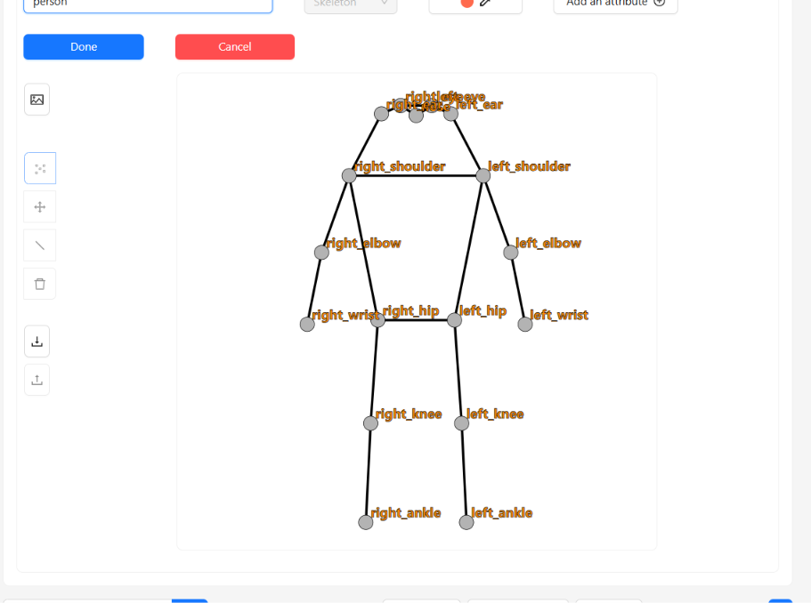
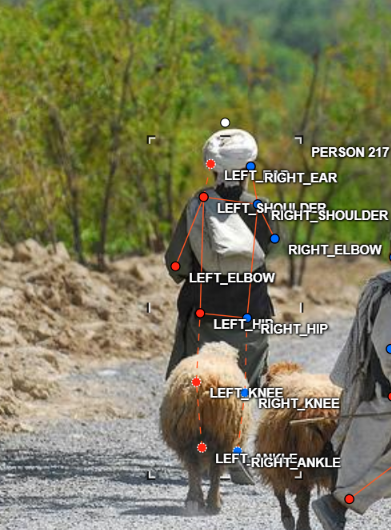
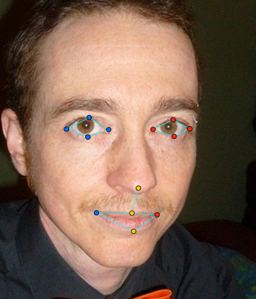
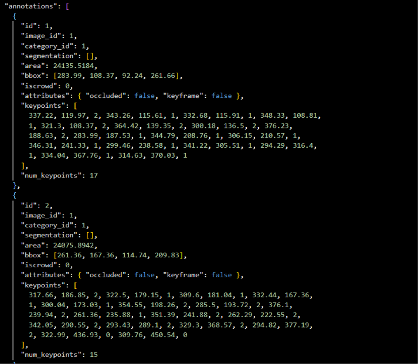

# Báo cáo cá nhân — HoVaTen-MSSV

Đổi tên file theo quy tắc `MSSV_HoTen.md`. Ví dụ: `20241234_NguyenVanAn.md`.

Dữ liệu: 12 ảnh người COCO val2017 (Lin et al., 2014) và 8 ảnh chân dung Wikimedia Commons, chỉ dùng trong lớp.

## 0. Thông tin học viên

- Họ tên: Hà Tiến Trịnh
- MSSV: 2A202603154
- Email: 26ai.trinhht@vinuni.edu.vn
- Link repository: https://github.com/HaTienTrinh/K5-L2A-DAY04-HaTienTrinh-2A202603154-KeypointPose
- Phiên bản CVAT (Help → About): 2.74.1
- Máy: hệ điều hành Windows 11 · RAM 16 GB · chạy CVAT chế độ đầy đủ 
- Bộ ảnh (`src/exports/assignment.json` do `lab.py setup` tạo): có 
- Giờ bắt đầu: 16:30 12/11/2026
- Giờ kết thúc: 3:33 13/11/2026

## 1. Kiểm tra label (CP0)

| Label | Kiểu | Số điểm | Tên điểm đúng bảng của lab? | Đúng thứ tự? | Số cạnh |
|---|---|---:|---|---|---:|
| `person` |Skeleton |17 |Có |Có |19 |
| `face` |Skeleton |13 |Có |Có |13 |

Mẫu `person` dựng theo người quay mặt về camera (các điểm `left_*` nằm bên phải khung mẫu)? Có 

Cách đổi cờ `occluded` / `outside` cho **một điểm** trên phiên bản CVAT này (một câu):

Rê chuột vào điểm cần đổi rồi nhấn phím Q để bật/tắt occluded (v=1), nhấn phím O để bật/tắt outside (v=0), hoặc nhấn chuột phải vào điểm đó để chọn cờ tương ứng từ menu ngữ cảnh.

## 2. Số lượng đã gán và thời gian (CP1, CP2)

| Nhóm ảnh | Số ảnh | Số skeleton đã gán | Số người dưới 60 px (không gán) | Số poster / gương / màn hình bỏ qua | Thời gian (phút) |
|---|---:|---:|---:|---:|---:|
| `easy` | 5 |5 |0 |0 |25 |
| `occluded` | 3 |5 |2 |0 |25 |
| `back` | 2 |3 |1 |0 |20 |
| `small` | 1 |1 |10 |0 |10 |
| `crowd` | 1 |3 |5 |0 |20 |
| `faces` | 8 |8 | — |0 |25 |

- Số ảnh người đã xong ở mốc phút 105: 10 / 10
- Thời gian thực tế (phút): CP1 100 · CP2 25 · CP3 60
- Ảnh tốn thời gian nhất là ảnh nào, vì sao?

Ảnh 000000130816.jpg (nhóm crowd) tốn thời gian nhất vì có nhiều người đứng đan xen, các khớp gối và cổ chân bị người phía trước che khuất một phần, phải lần theo từng khớp vai, khuỷu, cổ tay của từng người để tránh nối nhầm xương, đồng thời phải cân nhắc kỹ cờ v=1 hay v=0 cho các chân bị che.

## 3. Bảng ca khó (CP1, CP2)

Mỗi điểm bạn phân vân một dòng, nhất là phân vân giữa `v = 1` và `v = 0`, hoặc không chắc hướng người.

| Ảnh | Người / mặt | Điểm | Cờ đã chọn | Phân vân giữa | Lý do chọn |
|---|---|---|---:|---|---|
|000000188804.jpg |Người ngồi ở bàn |right_shoulder, right_elbow, right_wrist, right_knee |0 |v = 1 và v = 0 |Nửa người bên phải khuất hẳn sau bàn và màn hình máy tính, không xác định được vai, tay, cổ tay, gối nên chọn v=0 để tránh đoán bừa. |
|face_13874.jpg |Nữ đeo kính râm |4 điểm mắt |1 |v = 2 và v = 1 |Mắt bị tròng kính râm tối che khuất, không nhìn thấy con ngươi nhưng theo guideline kính râm chọn v=1 và đặt theo góc gọng kính. |
| | | | | | |

## 4. Bảng tự review (CP3)

Đi từ ảnh cuối về ảnh đầu. 5 ảnh người (ít nhất 2 ảnh `back` hoặc `crowd`) và 3 ảnh mặt. Ít nhất 8 dòng, kể cả dòng `ok`. Ghi lỗi trước, sửa sau.

Mã lỗi dùng đúng một trong: `lr_swap`, `vis_flag`, `position`, `missing`, `extra`, `ok`.

| Ảnh | Người / mặt | Điểm | Mã lỗi | Ghi chú | Đã sửa? |
|---|---|---|---|---|---|
|000000130816.jpg |Người quay lưng (mặc áo số 36) |left_wrist, right_wrist |lr_swap |Lúc đầu kéo nhầm tay trái sang bên phải ảnh |	Có |
|000000130816.jpg |Người đứng phía sau |left_knee, right_knee |vis_flag |Khớp gối bị người phía trước che nhưng lỡ để v=2 |Có (đã đổi thành v=1) |
|000000184224.jpg |Người che ô |nose, eyes |position |Chấm mắt lệch lên trán |Có (đã chỉnh vào tâm mắt) |
|000000253584.jpg |Người áo đen đứng bên trên banner |Cả người |extra |Lỡ gán người thấp hơn 60px |Có (đã xóa skeleton) |
|000000399983.jpg |Vận động viên tennis |_ |ok |Khớp chuẩn, đúng hướng trái phải |_ |
|face_122747.jpg |Mặt người đàn ông |left_eye_upper |position |Điểm mí trên đặt vào sợi lông mi |Có (đã dời về mép mí mắt) |
|face_13874.jpg |Nữ đeo kính râm |4 điểm mắt |vis_flag |Quên chưa bật occluded cho mắt sau tròng kính |Có (đã bật occluded) |
|face_333134.jpg |Khuôn mặt nữ |_ |ok |Đã đặt chuẩn các điểm khóe miệng và mí |_ |

Tổng hợp số lỗi theo mã:

| `lr_swap` | `vis_flag` | `position` | `missing` | `extra` | `ok` |
|---:|---:|---:|---:|---:|---:|
|1 |2 |2 |0 |1 |2 |

Điểm còn phân vân giữa `v = 1` và `v = 0` (ghi cả hai lựa chọn và lý do chọn):

Ở ảnh crowd 000000130816.jpg, chân của người đứng phía sau bị người phía trước che mất phần đùi. Phân vân giữa v=1 và v=0 nhưng vì góc đùi và cẳng chân lộ rõ phương thẳng đứng nên quyết định chọn v=1 (occluded).

## 5. Kiểm file xuất và kết quả tự kiểm (CP4)

Tự kiểm tay trong file JSON:

| File | Người / mặt kiểm (ảnh, thứ tự) | Số phần tử `keypoints` | Điểm `outside` ra `v = 0`, `occluded` ra `v = 1`? | `num_keypoints` khớp? |
|---|---|---:|---|---|
| `HaTienTrinh_persons.zip` |000000184224.jpg, #1 |51 |Có |Có |
| `HaTienTrinh_persons.zip` |000000480582.jpg, #1 |51 |Có |Có |
| `HaTienTrinh_faces.zip` |face_122747.jpg, #1 |39 |Có |Có |

Sau khi xuất, CVAT ghi `occluded` thành `v = 1` và `outside` thành `v = 0`. Tọa độ của điểm `outside` trong file là `0, 0` hay tọa độ cũ? 

Tọa độ của điểm `outside` trong file là: tọa độ cũ

Hai job đã chuyển sang completed trên CVAT? Có 

Dán phần **TÓM TẮT** in ra từ `src/check_submission.py`:

```text
- File person: HaTienTrinh_persons.zip
  Số ảnh: 12 · số skeleton `person`: 17 · mỗi annotation 51 số
  Skeleton theo ảnh: 000000130816=3, 000000184224=1, 000000188804=2, 000000253584=1, 000000349521=1, 000000399983=1, 000000433787=1, 000000445187=1, 000000480582=2, 000000515309=1, 000000516902=1, 000000521817=2
  Cờ v: v=2 195 (67%) · v=1 61 (21%) · v=0 33 (11%)
  num_keypoints trung bình: 15.1
- File face: HaTienTrinh_faces.zip
  Số ảnh: 8 · số skeleton `face`: 8 · mỗi annotation 39 số
  Skeleton theo ảnh: face_122747=1, face_13874=1, face_145621=1, face_249336=1, face_261458=1, face_333134=1, face_356144=1, face_425647=1
  Cờ v: v=2 95 (91%) · v=1 9 (9%) · v=0 0 (0%)
  num_keypoints trung bình: 13.0
- Ghi chú: 33 điểm v = 0 vẫn mang tọa độ cũ (CVAT 2.x xuất như vậy; chuẩn COCO ghi 0, 0). Không phải lỗi: điểm v = 0 bị bỏ qua khi huấn luyện và khi chấm.
- Số [LỖI]: 0 · số [CẢNH BÁO]: 3
Kết quả: ĐẠT (đọc lại từng cảnh báo ở trên)
```

Các `[CẢNH BÁO]` còn giữ nguyên và lý do:

- 000000188804.jpg #1: cặp ankle nằm ngược phía so với các cặp còn lại. Có thể đổi trái/phải một cặp (`lr_swap`), hoặc tay / chân bắt chéo thật: kiểm lại.
- 000000480582.jpg #1: cặp hip, knee, ankle nằm ngược phía so với các cặp còn lại. Có thể đổi trái/phải một cặp (`lr_swap`), hoặc tay / chân bắt chéo thật: kiểm lại.
- 000000521817.jpg #1: cặp eye, ear nằm ngược phía so với các cặp còn lại. Có thể đổi trái/phải một cặp (`lr_swap`), hoặc tay / chân bắt chéo thật: kiểm lại.

## 6. Ảnh chụp màn hình

1. Label `person` trong label constructor (đủ 17 điểm có tên):

   

2. Một người quay lưng đã gán, cờ đã đặt:

   

3. Một khuôn mặt đã gán 13 điểm, phóng to vùng mắt:

   

4. Một đoạn JSON xuất của một người:

   

Nguồn ảnh: COCO val2017 / Wikimedia Commons.

## 7. Tự đánh giá

1. Lỗi bạn mắc nhiều nhất hôm nay, và cách bạn sẽ tránh ở dự án thật:

   Hay nhầm bên trái và phải khi gặp người quay lưng và đứng nghiêng. Cách tránh: trước khi chấm điểm, tự tưởng tượng mình đứng cùng với hướng của người đó để xác định đúng hơn.

2. Một quy tắc bạn đề xuất thêm vào guideline (kèm ảnh ví dụ nếu có):

   Em đề xuất bổ sung hướng dẫn thêm cho trường hợp người mặc đồ rộng (000000253584.jpg, 000000349521.jpg)

3. Nhãn của bạn đi vào model ở đâu? Chọn một lỗi bạn đã sửa và nói nó sẽ làm model học sai thế nào (heatmap, trọng số trong loss, hay bước lật ảnh):

   - Tọa độ các điểm keypoint được dùng để tạo các đốm sáng dạy cho mô hình nhận diện các khớp sương trong cơ thể
   - Việc gán nhầm tay ( như lỗi em đã gặp phải): khi mô hình lật ngược ảnh để học thêm trong lúc huấn luyện, sẽ khiến mô hình bị sai và ảnh hưởng đến chất lượng của mô hình

## 8. Khó khăn và lỗi kỹ thuật

Không có.

## Bonus (nếu làm)

### B1 — 3 ảnh người khó thêm

| Ảnh | Số skeleton | Số người dưới 60 px | Ca khó nhất |
|---|---:|---:|---|
| | | | |
| | | | |
| | | | |

Kết quả `src/check_submission.py` cho `HoVaTen_bonus_persons.zip`:

```text
(dán ở đây)
```

### B2 — 5 ảnh khuôn mặt đen trắng / hồng ngoại

Ảnh không màu khó hơn ở điểm nào? Kính râm trên ảnh hồng ngoại có còn là `v = 1` không?

...

### B3 — Model so với nhãn của tôi (không tính điểm)

- Demo đã dùng:
- Ảnh đã thử:

1. Model có trả điểm cho khớp bị che, hay khớp ngoài ảnh không? Confidence ở các điểm đó thế nào?

   ...

2. Với người quay lưng, model có đổi trái/phải không?

   ...

3. Bộ điểm của model có giống 17 điểm COCO không?

   ...

## 9. Tài liệu tham khảo và công cụ AI đã dùng

- Trợ lý AI (Antigravity / Gemini) hỗ trợ tra cứu cú pháp Docker, giải thích lỗi đường dẫn Windows/WSL và tìm hiểu cơ chế OKS/Heatmap.
- Tài liệu COCO Dataset (Keypoints Annotation Format).
